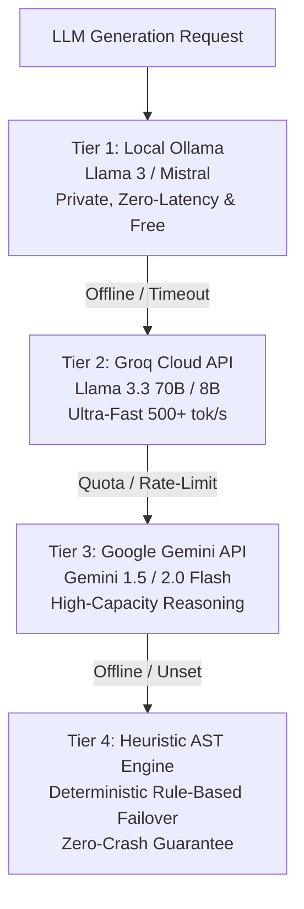

# Job Hunt Orchestrator 🚀

[](https://www.python.org/)
[](https://fastapi.tiangolo.com/)
[](https://playwright.dev/)
[](https://github.com/langchain-ai/langgraph)
[](https://tailwindcss.com/)
[](LICENSE)

An enterprise-grade, autonomous, multi-agent AI command center and web application engineered to scale and automate the job application pipeline in the **GenAI / Autonomous Agent / LLM Systems** engineering market across **India (Pune GCCs & Tech Hubs)** and the **UAE (Dubai & Abu Dhabi)**.

---

## 🌟 Key Highlights & Core Capabilities

- **🌐 Multi-Portal Autonomous Job Application Engine:**
  - **Naukri.com:** Search scraper, automated Easy Apply, and Path 3 external ATS redirection handling.
  - **Bayt.com:** Gulf-focused algorithmic freshness engine and automated application sequencing.
  - **Indeed:** Headless session restoration, Easy Apply sequence, and external portal redirect navigation.
  - **Cutshort:** Indian high-signal startup auto-apply engine with profile sync.
  - **Wellfound (AngelList):** Startup & global remote auto-apply with compensation filtering.
- **⚡ Path 3 Adaptive External ATS Engine:**
  - Seamlessly handles external redirects from job boards into **Workday (`myworkdayjobs.com`)**, **Lever**, **Greenhouse**, and custom proprietary company ATS portals.
  - Automatic input matching (Full Name, Phone, Email, Experience, Notice Period, Current & Expected CTC, Residency status, Relocation readiness).
  - Handles multi-step form pagination, file upload triggers, and interactive modal dialogs.
- **🔐 Dedicated SSO Hub & Browser Session Persistence:**
  - Standalone desktop login launchers (`login_naukri_sso.bat`, `login_bayt_sso.bat`) using native Microsoft Edge / Chrome in separate user data directories.
  - One-time human OTP/2FA solve with automated cookie/storage persistence into `sessions/`.
  - Real-time SSO health status indicators in the UI dashboard.
- **💻 Real-Time Glassmorphism Web Command Center:**
  - Served via **FastAPI** with Tailwind CSS glassmorphism UI, FontAwesome iconography, and live event polling.
  - **Live Mode vs. Safe Dry Run:** Instant toggle to preview and audit applications with proof screenshots without submitting, or execute live applications.
  - **Interactive Ledger Management:** Filter, sort, view high-res proof screenshots, and perform single-row or bulk deletion (`Delete Selected (N)`) with master checkboxes.
  - **Failed Application Recovery:** One-click `"Retry Failed Applications"` engine with automated deduplication.
  - **Candidate Profile & Resume Vault:** Live candidate profile editor and drag-and-drop persistent PDF resume uploader (`data/resumes/candidate_resume.pdf`).
  - **Human-in-the-Loop Modal:** Catches unknown portal screening questions and saves verified candidate answers to persistent memory.
- **📱 Remote Mobile Command Center:**
  - One-click script (`start_mobile_orchestrator.bat` / `start_mobile_service.ps1`) spins up a secure Cloudflare Tunnel (`trycloudflare.com`) on `0.0.0.0:8000`.
  - Automatically displays local Wi-Fi URLs and generates a terminal QR Code for instant mobile smartphone access without router port-forwarding.
- **🧠 4-Tier Zero-Crash LLM Router:**
  - Automated fallback routing: **Tier 1 (Local Ollama Llama 3)** $\rightarrow$ **Tier 2 (Groq Cloud Llama 3.3 70B)** $\rightarrow$ **Tier 3 (Google Gemini 1.5/2.0 Flash)** $\rightarrow$ **Tier 4 (Deterministic Heuristic Rules)**.

---

## 🏛️ System Architecture

```text
Job Hunt Orchestrator
├── config/                     # Settings (Pydantic), environment validation, path resolver
├── data/                       # Application data & persistent storage
│   ├── candidate_profile.example.json # Public candidate profile template (credentials, preferences, compensation)
│   ├── templates/              # ATS-compliant base Markdown resume & CSS stylesheet
│   └── mock_ats_portal.html    # Local mock ATS test environment
├── logs/                       # Rotating application logs & proof screenshots (.png)
├── sessions/                   # Persisted Playwright storage states (cookies/auth)
├── src/
│   ├── api/                    # FastAPI web server, routes, and glassmorphism UI
│   │   ├── main.py             # FastAPI application, background workers, REST endpoints
│   │   └── templates/
│   │       └── index.html      # Responsive Single-Page Command Center dashboard
│   ├── automation/             # Playwright browser engines, scrapers, and cron orchestrators
│   │   ├── browser_factory.py  # Stealth browser context & session manager
│   │   ├── ats_engine.py       # Adaptive ATS & Workday external form engine
│   │   ├── portal_apply_engine.py # Multi-portal apply coordinator (Indeed, Cutshort, Wellfound)
│   │   ├── naukri_apply_engine.py # Naukri.com auto-apply & external redirect handler
│   │   ├── freshness_cron.py   # Module 1: Algorithmic Freshness (Naukri & Bayt)
│   │   ├── hourly_apply_cron.py# Scheduled autonomous application batch runner
│   │   ├── sso_manager.py      # SSO session verification & interactive browser launcher
│   │   ├── cutshort_scraper.py # Cutshort job scraper & ledger sync
│   │   ├── indeed_scraper.py   # Indeed job scraper & ledger sync
│   │   ├── naukri_scraper.py   # Naukri job scraper & ledger sync
│   │   ├── wellfound_scraper.py# Wellfound job scraper & ledger sync
│   │   └── pending_questions_manager.py # Human-in-the-loop screening question store
│   ├── agents/                 # LangGraph & CrewAI workflows
│   │   ├── lead_generator/     # Module 2: Apollo/Hunter + Google Sheets CRM agent
│   │   ├── resume_tailor/      # Module 3: Markdown & Dual-Engine PDF compiler
│   │   ├── outreach_drafter/   # Module 4: 3-paragraph Cover Letter & 150-word InMail
│   │   └── simulator/          # Module 6: Ollama Llama 3 salary counter-offer coach
│   ├── core/                   # Profile repository, LLM router, logger, env validation
│   └── integrations/           # Apollo, Hunter, Google Sheets, Gmail API, Ollama clients
├── tests/                      # Automated test suite (UI, scrapers, engines, verifications)
├── Dockerfile.freshness        # Containerized headless Playwright runner
├── docker-compose.freshness.yml# Persistent multi-container orchestration
├── login_bayt_sso.bat          # Desktop SSO launcher for Bayt.com
├── login_naukri_sso.bat        # Desktop SSO launcher for Naukri.com
├── start_mobile_orchestrator.bat # Mobile access & Cloudflare Tunnel launcher
├── requirements.txt            # Production dependencies
└── tasks.txt                   # Implementation backlog & milestone tracker
```

---

## 💻 Web Command Center UI Dashboard

The centralized dashboard is served directly via FastAPI and allows full visual control over all automated workflows.

### Starting the Dashboard:
```bash
# Windows / PowerShell
.\.venv\Scripts\python.exe -m uvicorn src.api.main:app --reload --host 127.0.0.1 --port 8000

# macOS / Linux
python -m uvicorn src.api.main:app --reload --host 127.0.0.1 --port 8000
```
Open your browser at **`http://127.0.0.1:8000`**.

### Key UI Features:
1. **Interactive SSO Hub:** View live connection status for Naukri, Bayt, Indeed, Cutshort, and Wellfound. Launch dedicated desktop browser windows with 1 click to refresh authentication cookies.
2. **Autonomous Multi-Portal Apply Controls:** Select target portals (Naukri, Indeed, Cutshort, Wellfound), choose between **Live Submission** or **Dry Run**, and launch autonomous cycles.
3. **Application Ledger with Bulk Delete:**
   - Real-time audit table of all processed applications.
   - High-resolution proof screenshots captured automatically upon completion or error.
   - Clean standardized status badges: `applied` (green) and `failed` (red).
   - Single-row deletion via trash can button.
   - Multi-select checkboxes with a master "Select All" toggle and dynamic **"Delete Selected (N)"** action button.
4. **Error Recovery & Deduplication:** One-click `"Retry Failed Applications"` sweeps the ledger, extracts failed or errored entries, and re-runs them with updated parameters.
5. **Persistent Candidate Profile & Resume Vault:** Upload your active PDF resume with instant drag-and-drop, track file size and upload timestamps, and fine-tune compensation targets for India (LPA) and Dubai (AED).
6. **Screening Questions HITL Modal:** When scrapers encounter unfamiliar questions (e.g., specific visa questions, GPA, certifications), a modal alerts the user to confirm the answer, immediately unblocking the pipeline and storing the answer for future runs.

---

## 📱 Mobile Remote Access & Cloudflare Tunnel

To operate and monitor the orchestrator on your smartphone (iOS / Android) from anywhere in the world without port-forwarding:

```bash
# Run the mobile orchestrator launcher
start_mobile_orchestrator.bat
```

What this does automatically:
1. Boots the FastAPI backend on `0.0.0.0:8000`.
2. Establishes an encrypted, authenticated **Cloudflare Tunnel** (`https://<random-id>.trycloudflare.com`).
3. Prints the public HTTPS URL and renders a scannable **QR Code** directly in your console.
4. Scan the QR code with your phone's camera to immediately access the dashboard on mobile.

---

## 🚀 Implemented Modules & CLI Commands

### Module 1: Algorithmic Freshness Cron Job (Naukri & Bayt.com)
Performs automated daily micro-edits on Naukri.com and Bayt.com to trigger "Recently Updated" recruiter algorithm ranking boosts.
- **Gulf Timezone Window:** Enforces 10:00 AM – 1:00 PM GST execution for Bayt.
```bash
# Run freshness cycle for all configured portals
python -m src.automation.freshness_cron --platform all

# Interactive bootstrap (solves OTP/login once and saves cookies to sessions/)
python -m src.automation.freshness_cron --platform naukri --interactive
```

### Module 2: Lead Generation & CRM Agent (Apollo / Hunter / Google Sheets)
Scrapes engineering leadership (*CTO, Founder, VP Eng, Head of AI*) at boutique digital transformation agencies (10-50 employees) in Dubai and GCC enterprise hubs in Pune.
- Reads target domains from Google Sheets CRM.
- Syncs contact records to Google Sheets and persists to local backup CSV (`data/leads_crm_backup.csv`).
```bash
# Scrape single domain
python -m src.agents.lead_generator.crm_agent --domain derq.com --location "Dubai, UAE"

# Sync full target list from Google Sheets CRM
python -m src.agents.lead_generator.crm_agent --sync-sheet
```

### Module 3: Dynamic Resume Tailoring Agent (LangGraph + Dual-Engine PDF)
Analyzes target JDs, classifies technical focus (`multi_agent`, `rag_retrieval`, `network_telemetry`, `conversational_bi`), reorders anchor projects, and rewrites the executive summary with quantifiable metrics.
- **Dual PDF Engine:** Compiles via WeasyPrint or natively via Playwright Headless Chromium (`page.pdf()`).
```bash
# Tailor resume for Dubai benchmark JD
python -m src.agents.resume_tailor.cli --sample dubai

# Tailor resume for custom JD text file
python -m src.agents.resume_tailor.cli --jd-file ./my_target_jd.txt --company "Acme AI"
```

### Module 4: Context-Aware Cover Letter & DM Drafter (LangGraph + Gmail API)
Identifies the core operational bottleneck in the target JD, maps it to the candidate's specific production achievements, and generates:
1. **Formal 3-Paragraph Cover Letter** for ATS uploads.
2. **Punchy 150-Word Direct Message** for LinkedIn InMail or Cutshort.
3. Automatically syncs the drafted email directly into your **Gmail Drafts** via the Gmail API.
```bash
python -m src.agents.outreach_drafter.cli --sample dubai --company "Falcon AI" --recipient-name "Tariq Al-Mansoor" --recipient-email "tariq@falconai.ae"
```

### Module 5: Autonomous Multi-Portal Apply Engine (Playwright)
Autonomously navigates and completes application forms on **Naukri**, **Indeed**, **Cutshort**, **Wellfound**, **Workday**, **Lever**, and **Greenhouse**.
- **Gulf & India Formatter:** Automatically adapts compensation (INR vs. AED), notice period ("Serving notice / 30 days"), and relocation status.
- **Proof Screenshots:** Automatically saved into `logs/screenshots/` with exact timestamped audit trails.
```bash
# Safe dry-run test on application URL
python -m src.automation.auto_apply_orchestrator --url "https://jobs.lever.co/example/engineer" --location "Dubai, UAE"

# Live submission mode
python -m src.automation.auto_apply_orchestrator --url "https://example.myworkdayjobs.com/apply" --location "Dubai, UAE" --submit
```

### Module 6: Counter-Offer & Interview Simulator (Ollama + Groq + Gemini)
Simulates high-stakes compensation negotiations between an ambitious candidate and demanding HR recruiters in Pune GCCs and Dubai boutique agencies.
- **Strict Confidentiality Guardrail:** Enforces zero disclosure of competing offer details while leveraging them to anchor **18–21+ LPA** (Pune) or **AED 18,000 – 22,000** (Dubai).
- **Tactical Negotiation Coach:** Provides real-time turn-by-turn scorecard (Anchoring, Confidentiality, Value Framing) and verbatim counter-rebuttal recommendations.
```bash
# Automated benchmark test (Pune GCC)
python -m src.agents.simulator.cli --scenario pune_gcc --benchmark

# Live interactive conversational negotiation session
python -m src.agents.simulator.cli --scenario pune_gcc --interactive
```

---

## 🧠 Tiered LLM Failover Architecture



Configure fallback credentials in your local `.env`:
```env
# Tier 2: Groq Cloud API
GROQ_API_KEY=gsk_...
GROQ_MODEL=llama-3.3-70b-versatile

# Tier 3: Google Gemini API
GEMINI_API_KEY=AIzaSy...
GEMINI_MODEL=gemini-1.5-flash
```

---

## 🧪 Automated Verification Test Suite

The project includes an end-to-end automated test suite covering all critical subsystems:

```bash
# Run the master verification suite
python tests/run_all_verifications.py
```

### Individual Test Suites:
| Test Script | Validates |
|---|---|
| `tests/test_clean_status.py` | Strict status standardization (`applied` and `failed`), eliminating legacy ambiguous statuses |
| `tests/test_persistent_resume.py` | Resume upload API, storage persistence, and dynamic engine resolution |
| `tests/test_live_mode.py` | Toggle enforcement between Live Mode submission and Safe Dry Run |
| `tests/test_error_retry.py` | Ledger error collection, scraper deduplication, and retry execution |
| `tests/test_portal_sso_ui.py` | SSO Hub cards, portal checkboxes, HTML tree integrity, and Playwright DOM checks |
| `tests/test_delete_jobs.py` | Single and bulk job ledger deletion REST endpoints |
| `tests/test_ui_delete_button.py` | UI interaction tests: select-all checkbox, row trash buttons, and dynamic toolbar |

---

## ⚙️ Quickstart & Local Setup

### 1. Clone & Set Up Environment
```bash
git clone https://github.com/AneeketDeo/job-hunt.git
cd job-hunt

# Create virtual environment
python -m venv .venv

# Activate virtual environment
# Windows:
.\.venv\Scripts\activate
# Linux/macOS:
source .venv/bin/activate

# Install dependencies
pip install -r requirements.txt

# Install Playwright browsers
playwright install chromium
```

### 2. Configure Environment Variables
Copy `.env.example` to `.env` and fill in your details:
```bash
cp .env.example .env
```

### 3. Launch the Application
```bash
# Start Web Command Center
python -m uvicorn src.api.main:app --reload --host 127.0.0.1 --port 8000
```
Open [http://127.0.0.1:8000](http://127.0.0.1:8000) in your browser.

---

## 🔒 Security & Privacy Practices

- **Zero Secrets Committed:** `.env`, `.pem`, and OAuth client secrets are strictly excluded via `.gitignore`.
- **Session Privacy:** Local browser session state (`sessions/*.json`) containing cookies and tokens is never tracked.
- **Safe Public Templates:** [data/candidate_profile.example.json](file:///v:/Development/Job%20Hunt/data/candidate_profile.example.json) provides a clean template structure while keeping personal credentials and runtime ledgers private.
- **Fail-Safe Dry Run:** Application testing defaults to dry-run mode with screenshot capture to prevent accidental submissions.

---

## 📄 License
This project is open-source under the [MIT License](LICENSE).
