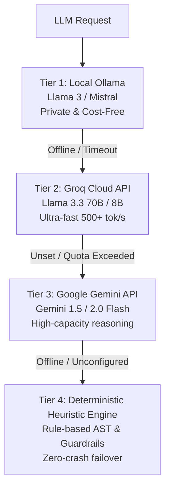

# Job Hunt Orchestrator 🚀

An autonomous, multi-agent AI application engineered to scale and accelerate the job search in the **GenAI / Agentic Systems** engineering market across **India (Pune GCCs)** and the **UAE (Dubai boutique agencies)**.

---

## 🏛️ System Architecture

```text
Job Hunt Orchestrator
├── config/                     # Settings (Pydantic), environment validation, timezones
├── data/
│   ├── profile_data.json       # Ground-truth candidate profile, anchor projects & metrics
│   ├── templates/              # ATS-compliant base Markdown resume & CSS stylesheet
│   ├── generated_resumes/      # Dynamically tailored Markdown, HTML, and PDF resumes
│   ├── drafts/                 # Saved cold outreach emails (.eml and metadata)
│   └── chroma_db/              # Vector database for JD chunking & RAG
├── logs/                       # Rotating application logs & proof screenshots (.png)
├── sessions/                   # Persisted Playwright storage states (cookies/auth)
├── src/
│   ├── core/                   # Loggers, security, webhook dispatcher
│   ├── automation/             # Playwright browser engine & portal bots
│   │   ├── browser_factory.py  # Stealth browser context & session manager
│   │   ├── freshness_cron.py   # Module 1: Algorithmic Freshness (Naukri & Bayt)
│   │   ├── workday_engine.py   # Module 5: Workday auto-apply engine
│   │   ├── ats_engine.py       # Module 5: Lever/Greenhouse form engine
│   │   └── auto_apply_orchestrator.py # Module 5: Unified auto-apply runner
│   ├── agents/                 # LangGraph & CrewAI workflows
│   │   ├── lead_generator/     # Module 2: Apollo/Hunter + Google Sheets CRM agent
│   │   ├── resume_tailor/      # Module 3: Markdown & Dual-Engine PDF compiler
│   │   ├── outreach_drafter/   # Module 4: 3-paragraph Cover Letter & 150-word InMail
│   │   └── simulator/          # Module 6: Ollama Llama 3 salary counter-offer coach
│   ├── integrations/           # Apollo, Hunter, Google Sheets, Gmail, Ollama clients
│   └── api/                    # FastAPI orchestration backend
├── Dockerfile.freshness        # Containerized headless Playwright runner
├── docker-compose.freshness.yml# Persistent multi-container orchestration
└── requirements.txt            # Production dependencies
```

---

## 💻 Web Command Center UI Dashboard

A unified, executive single-page web dashboard is served directly via FastAPI to monitor and trigger all 6 modules from a clean visual interface.

To start the UI Dashboard:
```bash
python -m uvicorn src.api.main:app --reload --host 127.0.0.1 --port 8000
```
Open your browser at: **`http://127.0.0.1:8000`**

### UI Dashboard Features:
- **Command Center:** Live system health, active LLM tier (Ollama / Groq / Gemini), Gulf peak window countdown (10–13 GST), and anchor candidate metrics.
- **Module 1 (Freshness):** Select portal (Naukri / Bayt), force execution override, and view live screenshot proof.
- **Module 2 (Leads & CRM):** Scrape company leadership (CTO, VP Eng, Founders) and inspect the live interactive CRM database.
- **Module 3 (Resume Tailor):** Paste JDs, trigger LangGraph analysis, review the tailored executive summary, and preview or download the generated ATS PDF directly.
- **Module 4 (Outreach & Gmail):** Preview the 150-word InMail message and 3-paragraph Cover Letter, with one-click saving to Gmail Drafts.
- **Module 5 (Auto-Apply):** Input job URLs (Workday / Lever / Greenhouse), configure Dubai salary formatters, run safe dry-run previews, and view full-page proof screenshots.
- **Module 6 (Salary Simulator):** Interactive live chat sparring against the HR Recruiter persona, complete with real-time Executive Coach scorecard and verbatim rebuttal recommendations.

---

## 🚀 Implemented Modules & Usage

### Module 1: Algorithmic Freshness Cron Job (Naukri & Bayt.com)
Performs automated daily micro-edits on Naukri.com and Bayt.com to trigger "Recently Updated" algorithmic recruiter search ranking.
- **Gulf Timezone Window:** Enforces 10:00 AM – 1:00 PM GST execution for Bayt.
```bash
# Run both platforms
python -m src.automation.freshness_cron --platform all

# Interactive bootstrap (solves OTP/login once and saves cookies to sessions/)
python -m src.automation.freshness_cron --platform naukri --interactive
```

### Module 2: Lead Generation & CRM Agent (Apollo / Hunter / Google Sheets)
Scrapes engineering leadership (*CTO, Founder, VP Eng, Head of AI*) at boutique digital transformation agencies (10-50 employees) in Dubai and GCC hubs in Pune.
- Reads target domains from Google Sheets CRM.
- Syncs contact records to Google Sheets and persists to local backup CSV (`data/leads_crm_backup.csv`).
```bash
# Scrape single domain
python -m src.agents.lead_generator.crm_agent --domain derq.com --location "Dubai, UAE"

# Sync full target list from Google Sheets CRM
python -m src.agents.lead_generator.crm_agent --sync-sheet
```

### Module 3: Dynamic Resume Tailoring Agent (LangGraph + Dual-Engine PDF)
Analyzes target JDs, classifies technical focus (`multi_agent`, `rag_retrieval`, `network_telemetry`, `conversational_bi`), reorders the 4 anchor projects, and rewrites the executive summary.
- **Dual PDF Engine:** Compiles via WeasyPrint or natively via Playwright Headless Chromium (`page.pdf()`).
```bash
# Tailor resume for Dubai benchmark JD
python -m src.agents.resume_tailor.cli --sample dubai

# Tailor resume for custom JD text file
python -m src.agents.resume_tailor.cli --jd-file ./my_target_jd.txt --company "Acme AI"
```

### Module 4: Context-Aware Cover Letter & DM Drafter (LangGraph + Gmail API)
Identifies the core operational bottleneck in the JD, maps it to the user's specific production metrics (e.g. 60% manual review reduction via Contract Redlining), and generates:
1. **Formal 3-Paragraph Cover Letter** for ATS uploads.
2. **Punchy 150-Word Direct Message** for LinkedIn InMail or Cutshort.
3. Saves the cold email directly into **Gmail Drafts** (or `.eml` fallback).
```bash
python -m src.agents.outreach_drafter.cli --sample dubai --company "Falcon AI" --recipient-name "Tariq Al-Mansoor" --recipient-email "tariq@falconai.ae"
```

### Module 5: Multi-Platform Auto-Apply Engine (Playwright)
Autonomously navigates and completes application forms on **Workday** (using stable `data-automation-id` selectors), **Lever**, and **Greenhouse**.
- **Dubai Formatter:** Injects local salary expectations (**AED 18,000 – 22,000**) and sets residency to **"Non-Resident / Willing to relocate - Immediately"**.
- **Standard Details:** Injects Phone (+919922425315), Email, LinkedIn, GitHub, and attaches the latest tailored PDF resume.
- **Safety Dry-Run:** Fills all fields and captures proof screenshots in `logs/` before submitting.
- **Fallback Webhook:** Pauses and notifies Discord/Slack if unrecognized questions or anti-bot challenges occur.
```bash
# Safe dry-run test on application URL
python -m src.automation.auto_apply_orchestrator --url "https://jobs.lever.co/example/engineer" --location "Dubai, UAE"

# Live submission mode
python -m src.automation.auto_apply_orchestrator --url "https://example.myworkdayjobs.com/apply" --location "Dubai, UAE" --submit
```

### Module 6: Counter-Offer & Interview Simulator (Ollama + Groq + Gemini)
Simulates high-stakes compensation negotiations between an ambitious GenAI engineer and demanding HR recruiters in Pune GCCs and Dubai boutique agencies.
- **Strict Confidentiality Guardrail:** Enforces zero disclosure of the competing 14 LPA offer company name while leveraging it to anchor **18-21+ LPA** (Pune) or **AED 18,000 – 22,000** (Dubai).
- **Metric-Based Framing:** Evaluates candidate arguments on hard quantifiable impact (*Contract Redlining 60% review reduction, AgentAssist 70% IT incident automation, Network RAG 40% MTTR reduction*).
- **Tactical Negotiation Coach:** Provides real-time turn-by-turn scorecard (Anchoring, Confidentiality, Value Framing) and verbatim counter-rebuttal scripts.
```bash
# Automated tactical benchmark test (Pune GCC)
python -m src.agents.simulator.cli --scenario pune_gcc --benchmark

# Automated tactical benchmark test (Dubai Agency)
python -m src.agents.simulator.cli --scenario dubai_agency --benchmark

# Live interactive conversational negotiation session
python -m src.agents.simulator.cli --scenario pune_gcc --interactive
```

---

## 🧠 Tiered LLM Failover Architecture

The system operates with an automated 4-tier LLM failover hierarchy across all agentic modules (Resume Tailoring, Outreach Drafting, and Interview Simulation):



Configure fallback keys in `.env`:
```env
# Tier 2: Groq Cloud API
GROQ_API_KEY=gsk_...
GROQ_MODEL=llama-3.3-70b-versatile

# Tier 3: Google Gemini API
GEMINI_API_KEY=AIzaSy...
GEMINI_MODEL=gemini-1.5-flash
```

---

## 📊 Ground Truth Candidate Profile
All agents reference [profile_data.json](file:///v:/Development/Job%20Hunt/data/profile_data.json):
- **Candidate:** GenAI Systems Engineer (3 YOE)
- **Anchor Projects:**
  1. *Contract Redlining System* (60% review reduction, BGE Large, BM25, Query Fusion)
  2. *AgentAssist* (70% IT incident automation, AutoGen GroupChatManager)
  3. *Network RAG* (~40% MTTR reduction)
  4. *QueryIQ* (~50% decision speed improvement)
- **Targets:**
  - Pune, India: 18 – 21+ LPA
  - Dubai, UAE: AED 18,000 – 22,000 / month
